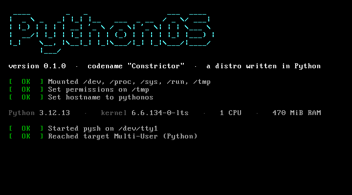
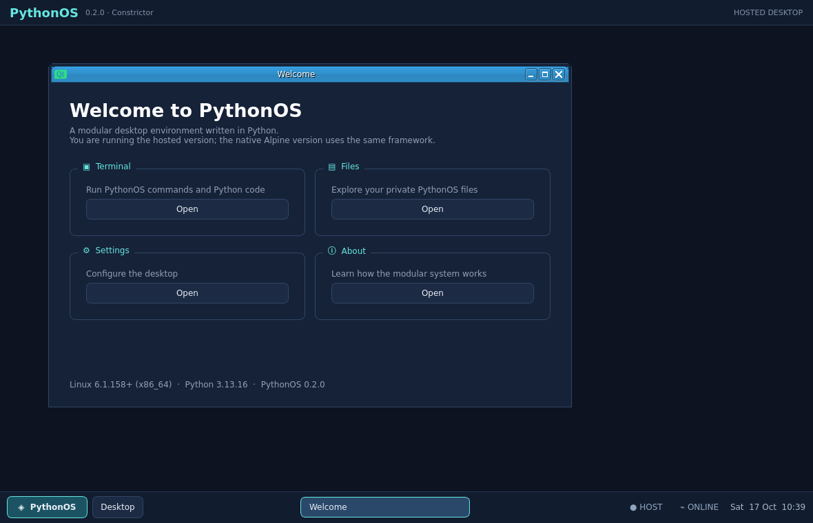

# PythonOS

[](https://github.com/ilovelinux774/Pythonos-lfs/actions/workflows/build.yml)

**A modular desktop operating system whose user-facing layer is Python.**

PythonOS has two modes:

1. **Hosted desktop** — clone the repository, install the Python requirements,
   and run `pythonos-desktop` on an existing Linux, Windows or macOS machine.
   No VM, second computer, ISO or reboot is needed.
2. **Native image** — boot Alpine Linux with OpenRC, then run the PythonOS
   native services and shell. The graphical native session will reuse the same
   Python framework built in hosted mode.

The goal is similar in spirit to Android's layered design: Linux, native
libraries and service management remain underneath; the desktop, framework
and applications users interact with are Python.



---

## Run the desktop now

Python 3.9 or newer is supported. On Windows PowerShell, run:

```powershell
git clone https://github.com/ilovelinux774/Pythonos-lfs.git
cd Pythonos-lfs

py -3.9 -m venv .venv
.\.venv\Scripts\Activate.ps1
python -m pip install --upgrade pip
python -m pip install -r requirements.txt

pythonos-desktop
```

If PowerShell blocks activation, either allow it for this terminal only:

```powershell
Set-ExecutionPolicy -Scope Process -ExecutionPolicy Bypass
.\.venv\Scripts\Activate.ps1
```

Activation is optional; this is equivalent and works in every PowerShell
session:

```powershell
.\.venv\Scripts\python.exe -m pip install -r requirements.txt
.\.venv\Scripts\python.exe -m pythonos.desktop.main
```

The first hosted desktop opens as a normal application window with:

- a PythonOS desktop and top identity panel
- a bottom taskbar with PythonOS launcher
- live buttons for every open application window
- minimize/restore desktop control
- clock and host/status indicators
- application launcher
- PythonOS terminal
- private virtual filesystem and file browser
- settings and about applications
- internal app launcher and terminal commands for opening PythonOS windows
- fullscreen mode
- the same Python application model that will be used by native mode

PySide6-Essentials supplies portable native windowing through Qt. The
PythonOS desktop logic is Python; Qt is the lower-level C++ graphics layer.
Qt uses X11/Wayland on Linux, Win32 on Windows and Cocoa on macOS, so hosted
mode does not depend on X11 being installed.

Try inside the PythonOS terminal:

```text
help
sysinfo
ls
py 6 * 7
apps
open files
run settings
```

The launcher and the `apps`, `open` and `run` terminal commands all target
PythonOS applications. Each application opens as a managed window inside the
PythonOS desktop and gets a taskbar button; it does not depend on an external
host application registry.

Hosted files are kept safely in `~/.pythonos/files` by default. PythonOS does
not treat the host's entire filesystem as its own root.



## Architecture

```text
Hosted mode                         Native mode
─────────────                       ───────────
pythonos-desktop                    Linux kernel
      │                                  │
PySide6 / Qt                         Alpine + BusyBox
      │                                  │
PythonOS desktop                    OpenRC
      │                                  │
Python apps + services              PythonOS services
                                         │
                                   Python desktop
```

The shared boundary is platform services. Desktop code asks for operations
such as `list_processes`, `get_clipboard`, `open_file` and
`launch_application`; the hosted and native backends implement them
separately. This keeps applications portable and leaves room for a later
phone backend with touch, battery, rotation and mobile navigation.

Read the detailed design in [`docs/MODULAR.md`](docs/MODULAR.md).

## Native Alpine/OpenRC image

Alpine is intentional. Reusing Alpine's kernel-facing plumbing, musl,
BusyBox and OpenRC lets us spend time on the Python framework instead of
reimplementing a package manager, service manager and low-level Linux base.

The native boot chain is:

```text
Linux kernel
  → /init compatibility wrapper
  → Alpine BusyBox init
  → OpenRC sysinit / boot / default
  → PythonOS OpenRC service
  → pysh gettys on tty1 and ttyS0
```

OpenRC owns PID 1 service management. Python is the framework and userland
layer above it. This is more robust than replacing a production init system
with a custom Python PID 1.

## Download and run the ready-made ISO

You do not need to install Python, Qt, Alpine, OpenRC or the build tools on
the computer that will run PythonOS. Download the latest prebuilt image from
[GitHub Releases](https://github.com/ilovelinux774/Pythonos-lfs/releases/latest):

```text
pythonos-0.1.iso
```

Write it to a USB stick or boot it directly in QEMU:

```sh
qemu-system-x86_64 -m 768 -smp 1 -vga std -cdrom pythonos-0.1.iso
```

For VirtualBox, create an x86_64 VM with at least 768 MB RAM, 128 MB video
memory, and the `VMSVGA` graphics controller. Disable 3D Acceleration for the
most reliable first boot, then attach the ISO to the optical drive and start
the VM. The image includes VirtualBox's `vmwgfx`/`vboxvideo` kernel paths,
eudev/libinput mouse hotplug support, the Xorg vmmouse PS/2 fallback and
Xorg VMware/VESA graphics fallbacks.

The ISO already contains the Alpine base, OpenRC, PythonOS, Xorg, PySide6,
the matching kernel and the native desktop dependencies. The GitHub Actions
build also publishes the ISO as a downloadable workflow artifact for every
successful `main` build. Compilation is only needed by contributors who want
to rebuild the distribution. The 27 MB `v0.1.0` image is the older
console-only release; use the larger current release for the GUI.

## Install PythonOS to disk

The native desktop includes an **Install PythonOS** application. The same
workflow is available from a tty with `pythonos-installer`. It provides four
paths: wipe and install, manual partitioning, install alongside a detected
Windows/Linux system, and an advanced manual guide. `lsblk`, filesystem labels
and read-only `/etc/os-release` inspection are used to detect existing systems.

Wipe mode is destructive and requires a second confirmation. Dual-boot mode
preserves detected systems and installs into a pre-created free Linux
partition; it does not silently shrink or erase another operating system.
Automatic partition resizing is not implemented: use the advanced guide or a
trusted partition editor to create free space before selecting dual boot.
Review a plan before writing:

```sh
sudo pythonos-installer detect
sudo pythonos-installer plan --mode dualboot --root /dev/sda3 --esp /dev/sda1
sudo pythonos-installer install --mode dualboot --root /dev/sda3 --esp /dev/sda1 --yes
```

For a blank disk, use `--mode wipe --disk /dev/sda --yes`. Back up important
data first. The installer supports both UEFI and legacy BIOS bootloaders.

Installed systems use a small storage-only initramfs and then switch to the
persistent root partition; they do not boot the large live desktop initramfs.
The GRUB menu includes `PythonOS (initramfs emergency shell)`. You can also
add `pythonos.debug=1` to a normal entry. If root discovery, mounting, or
`switch_root` fails, the same BusyBox shell opens automatically. Type `exit`
to retry boot. The recovery shell does not format or repair a disk
automatically.

## Build and test the native image

Requirements: `curl`, `cpio`, `xorriso`, `isolinux`, `syslinux-common`,
`qemu-system-x86`, `gzip` and `sudo`.

```sh
make rootfs     # download Alpine minirootfs + kernel, install Python/OpenRC
make iso        # overlay PythonOS, pack live + installed initramfs and build ISO
make test       # boot the live image in QEMU and run the guest self-test
make test-installed # boot a disposable installed root and test switch_root
make run        # boot it interactively

# Native graphical profile: matching Alpine LTS kernel + Xorg + PySide6
make rootfs-gui
make iso-gui
make test                 # serial/OpenRC self-test
make run-iso              # graphical QEMU boot; console getty remains available
```

The produced image is in `release/`:

- `release/pythonos-0.1.iso` — bootable hybrid ISO
- `release/initramfs-lts` — live Alpine + OpenRC + PythonOS filesystem
- `release/initramfs-installed` — small installed-system storage/root-mount initramfs

The live-image test boots the real initramfs with OpenRC and verifies:

```text
SELFTEST PASSED — 22 passed, 0 failed
```

It checks that OpenRC owns PID 1, that OpenRC reached the default runlevel,
that core filesystems are mounted, and that PythonOS's shell, text tools,
process tools, package manager and applications work.

The native GUI profile uses the kernel staged with the rootfs, so its DRM
modules cannot drift from the boot kernel. The build keeps the coherent DRM,
AGP/TTM, virtio, input and HID module families, removes unused firmware and
Qt/PySide6 payload, and enables the shared PythonOS desktop through the
`pythonos-gui` OpenRC service. On QEMU's `-vga std`, Xorg uses the bochs DRM
path and opens the same Welcome, Terminal, Files, Settings and About windows
as hosted mode. If the GUI cannot start, the OpenRC getty fallback remains on
`tty1` and `ttyS0` for diagnosis.

## Repository layout

```text
pythonos/                    portable hosted framework
├── desktop/main.py          PySide6 desktop, launcher and windows
├── desktop/platform.py      cross-platform host services
└── desktop/terminal.py      PythonOS hosted terminal

system/                      files overlaid into the native Alpine image
├── init                     /sbin/init compatibility wrapper
├── etc/init.d/pythonos      OpenRC PythonOS service
├── etc/inittab              tty1 + serial gettys
└── usr/lib/pythonos/        native tools, shell and OpenRC entry point

builder/
├── prepare_rootfs.sh        Alpine + Python + OpenRC staging
├── build.py                 overlay, OpenRC runlevels, initramfs and ISO
├── test_boot.sh             QEMU guest test
└── demo_shots.py            VGA proof capture

docs/
├── MODULAR.md               hosted/native architecture
├── OPENRC.md                native boot and service design
├── BUILD.md                 build guide
└── USERLAND.md              pysh command reference
```

## Design principles

- **Modular:** hosted and native backends share Python applications and UI
  contracts.
- **Practical:** Alpine, OpenRC, Qt and Linux are reused instead of being
  rewritten for the sake of saying everything is from scratch.
- **Portable:** hosted mode is the fastest development and demonstration
  path; native mode is the eventual independent operating system.
- **Honest:** the kernel, OpenRC, BusyBox, musl and Qt remain native code.
  The desktop and application layer users see is Python.

## Roadmap

- [x] Alpine-based bootable image
- [x] OpenRC native service management
- [x] PythonOS shell and native userland
- [x] Hosted `pythonos-desktop` launcher
- [x] Cross-platform desktop MVP with terminal, files, settings and launcher
- [ ] Shared application/plugin manifests between hosted and native modes
- [x] Native graphical session in the Alpine image
- [ ] Python window manager/compositor integration
- [ ] Network, audio and display services
- [ ] Persistent native installation
- [ ] Phone/mobile shell
- [ ] ARM64 image

## License

MIT — see [`LICENSE`](LICENSE).
