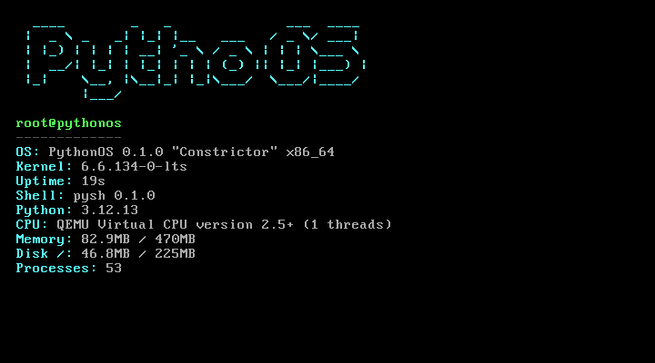
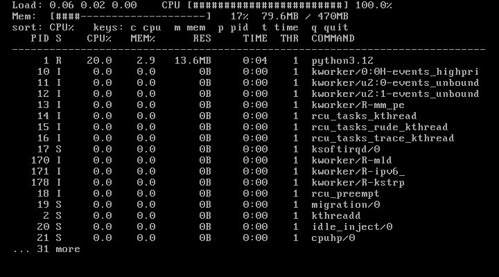
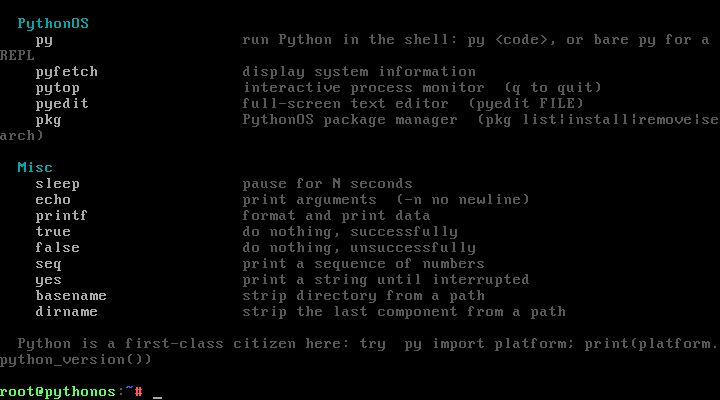
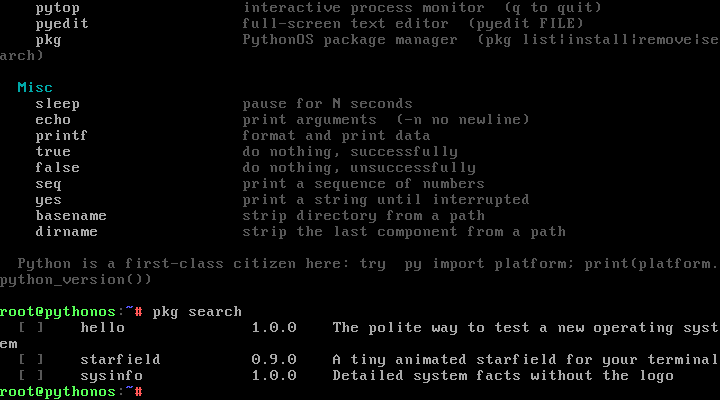

# PythonOS

[](https://github.com/ilovelinux774/Pythonos-lfs/actions/workflows/build.yml)

**A Linux distribution whose userland is Python.**

The kernel is Linux. Everything above it — PID 1, the init system, the shell,
every command you type and the package manager — is written in Python and
lives in this repository.

```
  ____        _   _                  ___  ____
 |  _ \ _   _| |_| |__   ___  _ __  / _ \/ ___|
 | |_) | | | | __| '_ \ / _ \| '_ \| | | \___ \
 |  __/| |_| | |_| | | | (_) | | | | |_| |___) |
 |_|    \__, |\__|_| |_|\___/|_| |_|\___/|____/
        |___/
```


---

## What this is

PythonOS is a from-scratch Linux distribution built around one idea: the
system software should be readable, hackable and Pythonic. There is no
`systemd`, no bash, no coreutils, no apt. There is a kernel, a root
filesystem, and a few thousand lines of Python that boot the machine.

| Layer | Implementation |
|---|---|
| Kernel | Linux 6.6 LTS (x86_64), taken unmodified from Alpine's netboot |
| Root filesystem | Minimal Alpine minirootfs + Python 3.12 (the only binaries) |
| PID 1 / init | `pythonos/init_main.py` — mounts, splash, spawning, reaping |
| Shell | `pysh` — tokenizer, parser, pipelines, redirection, globbing |
| Userland | ~40 builtins implemented as Python functions |
| Apps | `pyfetch`, `pytop` (htop), `pyedit` (editor), `pkg` (packages) |
| Package manager | `pkg` — installs Python apps from the on-disk repository |

The "from scratch" part is deliberate: no distribution tooling generates
this userland. The build copies `system/` into a minimal rootfs and packs
an initramfs. Read `docs/ARCHITECTURE.md` for the full picture.

## Screenshots

Taken from a real boot in QEMU (`builder/demo_shots.py` drives the VGA
console and captures the framebuffer — nothing here is mocked).

| | |
|---|---|
|  |  |
| `pyfetch` — system facts | `pytop` — live process monitor |
|  |  |
| `help` — every command is a builtin | `pkg search` — installed live |

## Boot it

**Download:** the ISO is attached to the [latest release](../../releases) and
can be written to a USB stick with `dd`.

**Run it in QEMU** (no installation needed, 30 seconds):

```sh
qemu-system-x86_64 -m 512 -cdrom pythonos-0.1.iso -serial mon:stdio
```

You will land in `pysh` as root, on the PythonOS splash, in about three
seconds.

### Try this

```
help                 # list every command (they are all Python functions)
pyfetch              # system information
pytop                # live process monitor        (q to quit)
pyedit notes.txt     # full-screen editor          (Ctrl-S save, Ctrl-Q quit)
pkg search           # the on-disk package repo
pkg install starfield
starfield            # an animated starfield, obviously
py "import this"     # it is that kind of system
ps; free; df; mount  # all builtins, all Python
```

Everything in that list — including `ps` reading `/proc`, `df` reading
`statvfs` and `pytop` drawing a live UI — is implemented in this repo.

## Build it

You need `gcc`, `qemu-system-x86`, `cpio`, `xorriso` and `sudo` (for the
one-time rootfs chroot). Then:

```sh
make rootfs     # download Alpine minirootfs + kernel, install Python (needs sudo)
make iso        # overlay the PythonOS tree, pack initramfs, build the ISO
make test       # boot the image in QEMU and run the in-guest self-test
make run        # boot it interactively
make shots      # re-capture the screenshots above
```

Output lands in `release/`:

* `release/pythonos-0.1.iso` — hybrid ISO, bootable from CD or USB
* `release/initramfs-lts` — the PythonOS root filesystem (cpio.gz)

`make test` is the real proof: QEMU boots the produced initramfs as PID 1
and prints

```
[SELFTEST PASSED] — 22 passed, 0 failed
```

The self-test checks that PID 1 is Python, that `/proc` and friends are
mounted, and then drives `pysh` through pipelines, redirects, globbing,
file round-trips, the text tools, both TUI apps and a full
`pkg install → run → remove` cycle. See `release/boot-selftest.log`.

CI does exactly this on every push — it stages the rootfs, builds the ISO,
boots it in QEMU and fails the build unless the self-test passes. The
badge above is that boot test, not a linter.

## Repository layout

```
system/                     everything that becomes the OS
├── init                    PID 1 entry point (kernel execs this)
├── etc/                    os-release, hostname, passwd, motd
├── usr/bin/                pysh, pyfetch, pytop, pyedit, pkg launchers
├── usr/lib/pythonos/
│   ├── init_main.py        boot, spawn shells, reap children, poweroff
│   ├── boot.py             mounts, splash, hardware detection
│   ├── syscalls.py         ctypes bindings: mount(2), reboot(2)
│   ├── selftest.py         the 22 checks run inside the image
│   ├── pysh/               the shell: tokenizer, parser, builtins
│   ├── tools/              pyfetch, pytop, pyedit, pkg
│   └── tui/                ANSI helpers, logo
└── usr/share/pythonos/repo/  the package repository (hello, sysinfo, starfield)

builder/                    the build system
├── prepare_rootfs.sh       stage 1: minimal rootfs + Python
├── build.py                stage 2: overlay, initramfs, ISO
├── test_boot.sh            boot in QEMU, assert the self-test
└── demo_shots.py           boot, drive the keyboard, capture screenshots

docs/                       architecture, userland reference, screenshots
tests/                      host-side unit tests (no QEMU required)
```

## Design notes

**Python is PID 1.** The kernel executes `/init`, which is a Python
script. `init_main.py` mounts `/proc`, `/sys`, `/dev` with `mount(2)` via
`ctypes`, sets the hostname, draws the splash, forks `pysh` onto
`/dev/tty1` and `/dev/ttyS0`, and supervises them — restarting a crashed
shell with backoff, reaping orphans, and handling `SIGTERM` as a request
to power off.

**The shell is a shell.** `pysh` is not a wrapper around `/bin/sh`. It
tokenizes quotes and operators, forks pipelines, applies `>` `>>` `<`
`2>` `2>&1`, expands `$VARS` and globs, tracks `$?`, supports `&&` / `||`
/ `;`, aliases, history via readline, and a `py` builtin that evaluates
Python in the live shell session.

**Booting before randomness exists.** An initramfs can be running before
the kernel's CRNG is seeded, and CPython refuses to start without a hash
seed. The build installs `/usr/bin/python3` as a tiny wrapper that defaults
`PYTHONHASHSEED=0`, so the OS boots deterministically on machines without
an entropy source (VMs without virtio-rng, embedded boards, CI).

**Everything is inspectable.** `help` lists builtins from the same
registry the shell dispatches from. `pkg` packages are directories with an
`app.json` and a `main.py` — you can read the entire userland in an
afternoon.

## Roadmap

- [x] Bootable ISO with Python as PID 1
- [x] `pysh` with pipelines, redirection, expansion, history
- [x] ~40 Python builtins (files, text, processes, system)
- [x] `pyfetch`, `pytop`, `pyedit`, `pkg`
- [x] In-guest self-test wired into the QEMU harness (22 checks)
- [ ] Persistent install mode (`pythonos --install /dev/sdX`)
- [ ] Users and permissions above root
- [ ] Networking (`ip` builtin, DHCP client in Python)
- [ ] `.pypkg` archives so `pkg` can fetch from a real repository
- [ ] ARM64 build
- [ ] Compile the kernel from source for full LFS purity

## License

MIT — see `LICENSE`.

PythonOS is a hobby operating system. It boots, it is honest about what it
is, and every line of the interesting parts is in this repository.
